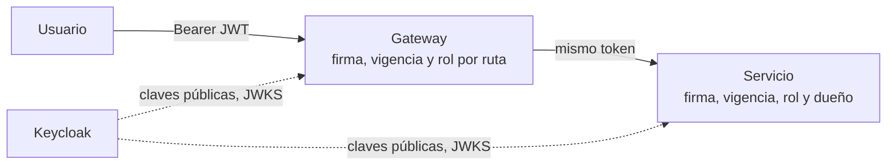

# Seguridad

Flety autentica con Keycloak y autoriza con JWT, sin tabla de usuarios: cada servicio guarda el `sub` del token como dueño de sus registros.

## Realm

El realm `flety` se importa desde [flety-realm.json](../infra/keycloak/flety-realm.json) al crear el contenedor de Keycloak, así el despliegue es reproducible. Si el contenedor ya existe, Keycloak saltea el import. Cómo pedir un token y cómo recrearlo está en [infra/keycloak/README.md](../infra/keycloak/README.md).

| Qué trae | Detalle |
|---|---|
| Roles de realm | `TRANSPORTISTA`, `DADOR` y `OPERADOR` |
| Cliente | `flety-test`: público y con Direct Access Grants, para pedir tokens desde curl, Postman o Swagger |
| Usuarios de prueba | `transportista1`, `transportista2`, `dador1` y `operador1`. Son solo para desarrollo |
| Vigencia del token | 30 minutos |
| Registro de usuarios | Apagado |

## Roles

| Rol | Quién es | Qué puede hacer |
|---|---|---|
| `TRANSPORTISTA` | Propietario-conductor | Registrar unidades y documentos, publicar retornos, buscar cargas de paso, proponer y registrar hitos |
| `DADOR` | Empresa con CUIT | Registrar su organización, publicar cargas, elegir propuestas, conformar o reclamar |
| `OPERADOR` | Personal de Flety | Verificar transportistas y documentos, resolver disputas |

## Qué trae el token

| Claim | Para qué se usa |
|---|---|
| `sub` | Es el id del usuario, y se compara con el dueño del recurso |
| `realm_access.roles` | Los roles. `RolesKeycloakConverter` los pasa a `ROLE_*`, porque Spring lee `scope` por defecto |
| `exp` | La vigencia. Vencido, responde 401 |

El token está firmado, no encriptado: cualquiera lo puede leer, pero nadie lo puede modificar sin invalidar la firma. Por eso se confía en lo que dice y no se ponen secretos adentro.

## Validación en dos capas

| Capa | Qué controla | Si falla |
|---|---|---|
| **Gateway** | Firma y vigencia del JWT, y el rol que pide la ruta ([rutas.md](gateway/rutas.md)) | 401 o 403 |
| **Servicio: token** | La misma firma y vigencia, con `SecurityFilterChain` de `flety-commons` | 401 |
| **Servicio: rol** | `@PreAuthorize` en cada controller | 403 |
| **Servicio: dueño** | RN-T1: compara el `sub` con el dueño del recurso | 403 |

**Por qué se valida dos veces.** Es defensa en profundidad: los servicios confían en que el tráfico viene del Gateway, pero no a ciegas. Un acceso directo tampoco pasa sin un token válido.

**Por qué el dueño lo controla el servicio.** El Gateway no sabe de quién es un recurso. `transportista2` tiene el mismo rol que `transportista1`, así que el Gateway lo deja pasar a un retorno ajeno, y el 403 lo da el servicio.

Las claves públicas se leen de `JWK_SET_URI`. Adentro de Docker es `http://keycloak:8080/realms/flety/protocol/openid-connect/certs`. Los servicios no validan el emisor, así que un token pedido desde la máquina (`localhost:8081`) vale igual adentro de la red.

## Qué se responde

| Código | Cuándo | Ejemplo |
|---|---|---|
| 401 | Falta el token, es inválido o venció | Pedido sin `Authorization` |
| 403 | El token es válido, pero el rol no alcanza o el recurso es de otro | Un DADOR que publica un retorno; `transportista2` con el retorno de `transportista1` |

Los dos salen como `ProblemDetail`, igual que el resto de los errores. El 401 agrega `WWW-Authenticate: Bearer`.

## Rutas sin token

`flety-commons` deja abiertos `/actuator/health`, para Docker, y `/v3/api-docs/**` y `/swagger-ui/**`, porque el Swagger lo expone el Gateway solo en desarrollo. Todo lo demás pide un JWT válido.

## Endpoints internos

`/internal/**` no tiene ruta en el Gateway, así que desde afuera responde 404. Solo se llega desde la red de Docker, y exige un token válido, pero no controla al dueño: `cargas-service` consulta unidades ajenas con el token de un dador al aceptar una propuesta. Por eso devuelve `transportistaSub`, y es `cargas-service` quien lo compara con el token cuando hace falta.

Solo el Gateway y Keycloak publican puertos. Los servicios y PostgreSQL quedan adentro de `flety-net`.

## Seguridad apagada en el perfil local

Con `flety.seguridad.habilitada=false` no se pide token, y `UsuarioLocalFilter` atiende los pedidos como un usuario fijo con los tres roles. Sirve para probar un servicio sin levantar Keycloak. Por defecto la seguridad está prendida, y no hay que apagarla en Docker.

## Cómo se prueba

Los tests no necesitan Keycloak. `TokensDePrueba` reemplaza solo el `JwtDecoder` por uno que reconoce tokens fijos. El resto de la cadena es la real: roles, `@PreAuthorize`, 401, 403 y `UsuarioActual`.

| Test | Qué cubre |
|---|---|
| `SeguridadAutoConfigurationTest` y `RolesKeycloakConverterTest` | La configuración base y la conversión de roles, en `flety-commons` |
| Tests de cada controller | 401 sin token, 403 por rol y 403 por dueño |

## Qué depende de otras tarjetas

| Tarjeta | Qué falta |
|---|---|
| FLY-14 | El Gateway todavía no está en el repo: la primera capa de la tabla es el diseño, y hoy solo corre la del servicio |
| FLY-35 | El reenvío del token en las llamadas internas |
| FLY-38 | El esquema Bearer y el botón Authorize de Swagger |
